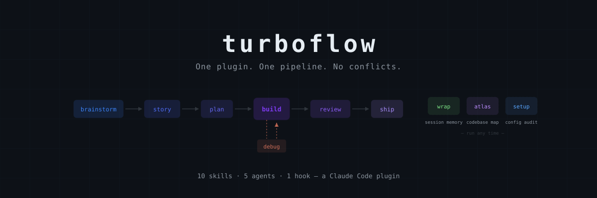
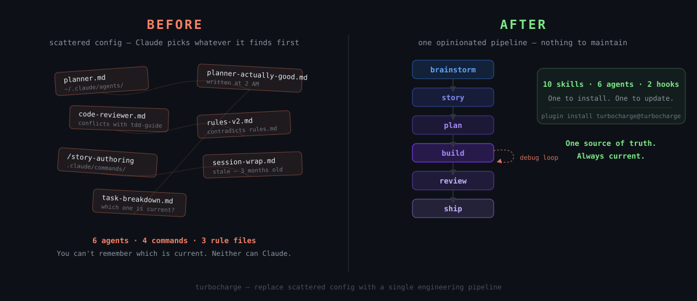
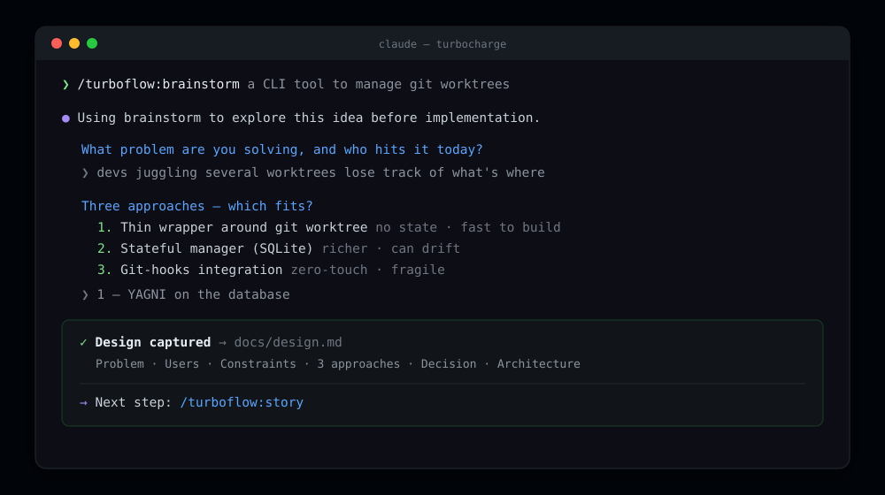
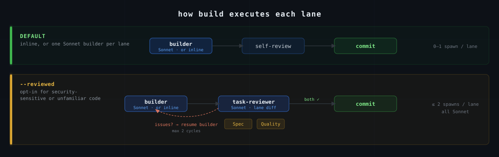
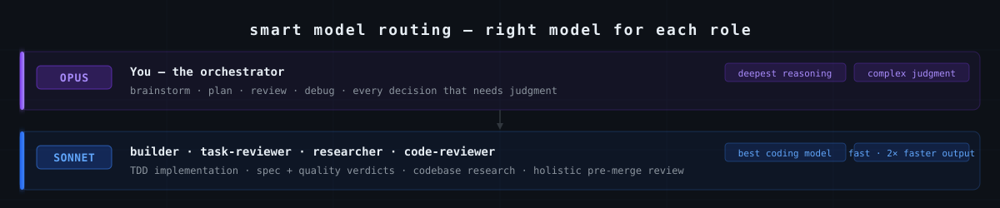

<p align="center">
  
</p>

<p align="center">
  <a href="LICENSE"></a>
  
  
  
</p>

---

You have 6 agents in `~/.claude/agents/`, 4 custom commands, 3 rule files that contradict each other, and a `planner-actually-good.md` you wrote at 2 AM. Claude picks whichever it finds first. You can't remember which is current. Neither can Claude.

**Turbocharge replaces all of it** with a single opinionated pipeline: 10 skills, 5 agents, 2 hooks. One system to install, nothing to maintain.

<p align="center">
  
</p>

## Install

Requires **Claude Code 2.1.288 or later** (`claude --version`).

Install **Turbocharge** from Claude's plugin directory. Claude Code has the directory built in, so there's no marketplace to add first:

```bash
claude plugin install turbocharge-nicodiansk@anthropic-plugin-directory
# later, to update:
claude plugin update turbocharge-nicodiansk@anthropic-plugin-directory
```

Or from this repo's marketplace, which gets each release as soon as it merges instead of after the directory's review:

```bash
claude plugin marketplace add nicodiansk/turbocharge
claude plugin install turbocharge@turbocharge
# later, to update:
claude plugin update turbocharge@turbocharge
```

Install one or the other, not both: both copies register the same `/turbocharge:` commands. In a session, `/plugin` → **Discover** → search "turbocharge" and pick `turbocharge-nicodiansk` also works.

Restart Claude Code, then start building:

```bash
/turbocharge:brainstorm I want to build a CLI tool that manages git worktrees
```

Every skill announces itself, does one job well, and hands you the next step:

<p align="center">
  
</p>

<details>
<summary>Other install methods</summary>

**Local development (per-session):**
```bash
claude --plugin-dir ./turbocharge
```
</details>

### Upgrading

From the directory or from 2.x, update as usual with the update command for your copy above. Your commands stay `/turbocharge:<skill>`, and your session snapshot and setup's CLAUDE.md blocks carry over. 3.x needs Claude Code 2.1.288 or later. Full notes are in the [CHANGELOG](CHANGELOG.md).

## Where it works

Turbocharge is built for **Claude Code**, where the whole pipeline runs. Each Claude app loads a different part of a plugin:

| | Claude Code | Cowork | Chat (claude.ai, desktop, mobile) |
|:--|:--:|:--:|:--:|
| 10 skills | ✓ | ✓ | ✓ |
| 5 agents (builder, reviewers, planner, researcher) | ✓ | ✓ | ignored |
| SessionStart hook | ✓ | ✓ | ignored |
| Builder exit gate hook (SubagentStop; PreToolUse on SubagentHandback) | ✓ | ✓ | ignored |

In Chat, agents and hooks are ignored, so the planning skills (`brainstorm`, `story`, `plan`) are the useful part there. `build`, `review`, `ship` and `debug` need a shell and git, which means Claude Code. A plugin you add on claude.ai also reaches Claude Code at your next session start.

## The Pipeline

```
brainstorm → story → plan → build → review → ship
                                ↑
                              debug
```

Enter at any step. Each skill gates the next. `debug` loops under `build` when bugs surface.

**`wrap`** stands alone — run it any time to capture session state, decisions, and a resume prompt for your next session.

**`atlas`** stands alone — generates `ATLAS.md` domain map from the actual codebase. Pre-loaded every session for zero-tool-call navigation.

| Skill | Command | What it does |
|:------|:--------|:-------------|
| **setup** | `/turbocharge:setup` | Audits config for conflicting agents/skills/rules. Bootstraps `CLAUDE.md`. |
| **atlas** | `/turbocharge:atlas` | Generates `ATLAS.md` domain map. Pre-loaded every session. |
| **brainstorm** | `/turbocharge:brainstorm` | Socratic requirements discovery before implementation |
| **story** | `/turbocharge:story` | INVEST-compliant story breakdown with acceptance criteria |
| **plan** | `/turbocharge:plan` | Lean plans — decisions, exact paths and test assertions in 2-5 min tasks, grouped into file-disjoint lanes |
| **build** | `/turbocharge:build` | Runs each lane inline or with one Sonnet builder, overlaps independent lanes, then one full-suite gate. Opt-in per-lane review (`--reviewed`). |
| **review** | `/turbocharge:review` | Holistic pre-merge code review against the original plan |
| **debug** | `/turbocharge:debug` | Systematic 4-phase root-cause investigation — no fix until cause is proven |
| **ship** | `/turbocharge:ship` | Test verification, then merge / PR / keep (discard only when you ask) |
| **wrap** | `/turbocharge:wrap` | Session continuity — captures state, generates resume prompt |

## Why a Pipeline

- **One source of truth.** No competing `planner-v2.md` files, no rules that contradict each other. Install once, update once.
- **Each step gates the next.** Requirements before stories, stories before plans, plans before code. The skill you skipped is usually the bug you ship.
- **Right model for each role.** Builders, reviewers, and researchers run on Sonnet — fast and focused. Your orchestration session runs whatever model you've configured, so you can reach for a more capable one on the planning and judgment calls.
- **Drop in anywhere.** Already have a plan? Start at `build`. Hit a bug? `debug`. Wrapping up? `wrap`. You're never forced through the whole chain.

## How Build Works

<p align="center">
  
</p>

A plan groups its tasks into **lanes** — sets of tasks that own disjoint files. Build routes each lane one of two ways:

- **Inline** — mechanical lanes (content edits, exact text in the plan) run in your main session, task by task. No spawn at all.
- **Builder** — lanes with real logic get one Sonnet builder for the whole lane, at the effort the plan sets.

Independent lanes **overlap**: builders work in the background while your session runs the inline lanes, and every commit is scoped to its lane's files. When all lanes finish, build runs the full suite **once** — the full-suite gate. A failure goes back to the lane that owns the file; a builder lane's fix round **resumes** the same builder, context and prompt cache intact, instead of paying for a fresh spawn.

`--inline` runs every lane in your session; `--delegate` gives every lane a builder. For security-sensitive or unfamiliar code, `--reviewed` adds one Sonnet `task-reviewer` per lane that reads the lane's diff once and returns Spec + Quality verdicts, looping fixes for up to two cycles. `--checkpoint` pauses for your feedback after each lane. After the gate, chain to `/turbocharge:review` for the final holistic assessment.

Plans written before 3.1 have no Lanes table; build runs them as one lane.

## Measured

Each eval case sends the same prompt to Claude in a fresh, empty workspace, once with Turbocharge loaded (**WITH**) and once with no plugin at all (**W/OUT**). **Δ** is the difference: what the plugin adds. **Fired** counts the runs in which the intended Turbocharge skill was invoked; it has no baseline, because without the plugin there is no skill to fire.

| Family | Cases | WITH | W/OUT | Δ | Fired |
|---|---|---|---|---|---|
| defects | 1 | 1.00 | 1.00 | +0.00 | 0/3 |
| planning | 1 | 1.00 | 0.50 | +0.50 | 3/3 |
| trigger | 4 | 0.83 | 0.83 | +0.00 | 4/9 |

- **Trigger** (4 cases): natural phrasing should reach the right skill, and its first move should fit: ask before building a vague feature, find the root cause of a failing test, flag the bug in a branch under review, fix a typo without ceremony.
- **Defects** (1 case): review a branch with 5 planted bugs against its spec. One grader per bug, plus one that penalizes false alarms.
- **Planning** (1 case): turn a CSV-export spec into a plan. Graded on whether the plan covers fields with commas or quotes (which the spec implies but never names) and whether every task names its files, a concrete expected result and a verify command.

What 3.3.0 shows: planning is where Turbocharge adds the most (+0.50; without it, tasks lacked concrete expected results or verify commands). Trigger and defects show no difference yet. Sonnet found all five planted bugs on its own, and `review` didn't fire on that longer prompt (0/3, though it fired 3/3 on "review my branch before I merge"). `brainstorm` never fired on "add CSV export to this tool" (0/3), so Claude built it straight away in both arms, and `debug` fired in 1 of 3 runs. Those are the targets for the next releases, measured against this baseline.

Claude Code 2.1.296 · model `claude-sonnet-5-5`, judge `claude-sonnet-5-5` · 3 runs per arm · 2026-10-13 · $2.97 list-price estimate (run on a Max plan, so it drew plan usage, not billing).

The suite lives in `evals/` and runs only when a maintainer runs `scripts/eval.sh` (`claude plugin eval`). It never runs in your sessions.

## Agents

Dispatched by skills. You never invoke them directly.

<p align="center">
  
</p>

| Agent | Role | Model |
|:------|:-----|:------|
| **builder** | TDD implementation, self-review, commits | Sonnet |
| **planner** | Task breakdown, verifies entity names against codebase | inherit |
| **researcher** | Fast background codebase exploration | Sonnet |
| **task-reviewer** | Spec + Quality verdicts on a lane diff (opt-in) | Sonnet |
| **code-reviewer** | Holistic pre-merge assessment | Sonnet |

All agents have `memory: project` for persistent codebase knowledge across sessions.

## Hooks

| Hook | When | What |
|:-----|:-----|:-----|
| **SessionStart** | Start of session | Loads `ATLAS.md` Where to Look table, injects CodeMap stats when `.codemap/` present, restores session snapshot, flags a missing CLAUDE.md (AGENTS.md-aware, including an AGENTS.md that `CLAUDE.local.md` keeps from loading) or ATLAS.md, checks ATLAS staleness. Each section is capped so the output stays under Claude Code's 10,000-char inline limit |
| **SubagentStop**, **PreToolUse** on `SubagentHandback` | A `turbocharge:builder` stops, or (auto mode) is about to hand back its report | Builder exit gate: keeps the builder going once while files it edited are uncommitted |

### What the hooks do

`hooks/session-start.sh` runs whenever a session starts, resumes, or is cleared or compacted. It is read-only: it prints text to stdout and does nothing else. It writes no files, changes no settings or permissions, and sends nothing over the network itself. What it prints becomes part of the session context, so it reaches the model like any file Claude reads.

| It reads | Why |
|:---------|:----|
| The plugin's own `hooks/*.md` | Bootstrap text and setup nudges |
| `ATLAS.md` | Its Where to Look table and its `atlas-hash` footer |
| `.claude/turbocharge-session.json` | The snapshot your last `/turbocharge:wrap` wrote, or the 3.0–3.1 `.claude/turboflow-session.json` when that one is newer |
| Whether `CLAUDE.md`, `.claude/CLAUDE.md`, `CLAUDE.local.md` or `AGENTS.md` exist | To pick a setup nudge. Their contents are not read, except `CLAUDE.local.md`'s lines, checked for an `@AGENTS.md` import |
| Top-level file and folder names | Hashed with `md5sum` (or `md5` on macOS) to spot a stale `ATLAS.md` |

| It runs | When |
|:--------|:-----|
| `codemap stats` | Only when the project has a `.codemap/` index and the `codemap` CLI is installed |

`hooks/builder-exit-gate.sh` runs when a `turbocharge:builder` subagent stops (`SubagentStop`), and in auto mode just before such a builder hands back its report (`PreToolUse` on `SubagentHandback`). For any other agent or tool it returns at once. It reads the hook input on stdin and that builder's transcript, lists the files the builder edited with Edit or Write, and runs `git status --porcelain` on those files only. If any are uncommitted, it keeps the builder going once per builder with "commit these by pathspec", or say why they must stay uncommitted. It writes no files, changes no settings, and sends nothing over the network. It needs `jq`, and does nothing without it. Inline lanes, which run in your main session, aren't covered.

**Not part of the plugin:** this repo's `.github/workflows` run Claude's GitHub Action on pull requests, using the repo's own `CLAUDE_CODE_OAUTH_TOKEN` secret. They're CI for maintaining Turbocharge: they never run on your machine and never load into your sessions.

## Quick Start Examples

```bash
# Full pipeline from scratch
/turbocharge:brainstorm I want to build a REST API for managing bookmarks

# Jump to planning with existing requirements
/turbocharge:plan docs/plans/my-feature-stories.md

# Debug a specific issue
/turbocharge:debug The auth middleware is rejecting valid tokens

# Wrap up your session
/turbocharge:wrap
```

See [`examples/`](examples/) for sample outputs from each stage.

## What to Remove After Installing

Turbocharge replaces scattered config. `/turbocharge:setup` handles this, but in short:

- Agents in `~/.claude/agents/` (planner, code-reviewer, tdd-guide, session-wrappers)
- Commands in `.claude/commands/` for story-authoring, task-breakdown, session-wrap
- Rule files that reference competing agents

## Project Structure

```
turbocharge/
├── .claude-plugin/
│   ├── plugin.json              # Plugin manifest
│   ├── icon.png                 # Plugin icon
│   └── marketplace.json         # Distribution config
├── skills/                      # 10 skill definitions
│   └── <skill-name>/SKILL.md
├── agents/                      # 5 agent definitions
│   └── <agent-name>.md
├── hooks/
│   ├── hooks.json               # Hook registration
│   ├── *.sh                     # Hook scripts (SessionStart, builder exit gate)
│   └── *.md                     # Hook content files
├── evals/                       # Eval suite (maintainer-only; never runs in your sessions)
├── scripts/
│   ├── validate.sh              # Plugin health check
│   ├── eval.sh                  # Runs the eval suite (claude plugin eval)
│   └── tests/                   # Content-shape tests
├── examples/                    # Sample pipeline outputs
├── CHANGELOG.md
└── README.md
```

## Validate

```bash
./scripts/validate.sh
```

## License

MIT — see [LICENSE](LICENSE).

---

<p align="center">
  <sub>Built by <a href="https://github.com/nicodiansk">@nicodiansk</a> — one pipeline to replace them all.</sub>
</p>
